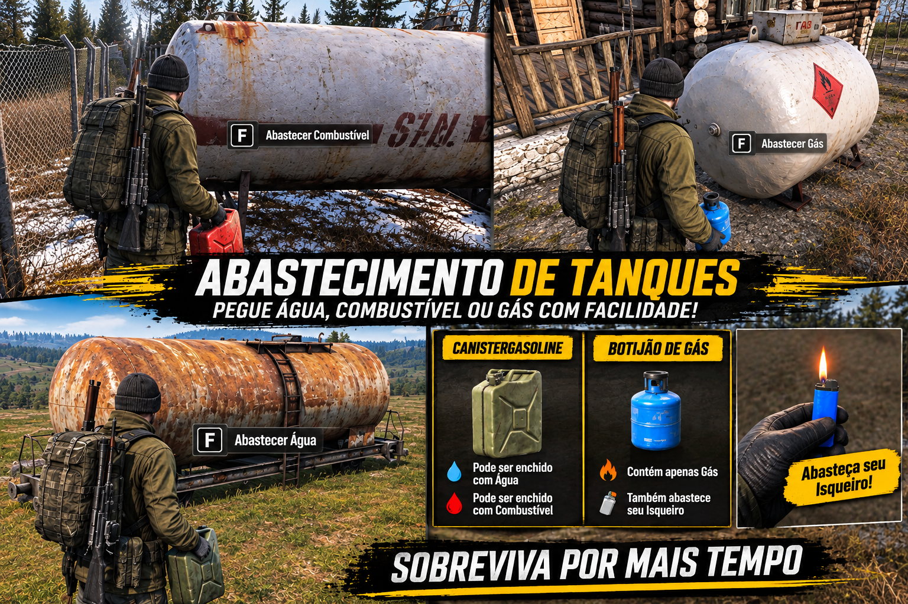

# ZDBRTank


Mod independente para **DayZ** desenvolvido para a comunidade **ZeroDawnBR** que permite reabastecer recipientes de **combustível**, **gás** e **água** diretamente nas válvulas das extremidades ou escotilhas superiores de tanques estáticos e vagões-tanque espalhados pelo mapa.



---

## Funcionalidades

- **Abastecimento Direcionado por Ponto de Abertura**: A ação só aparece quando o jogador se aproxima e mira exatamente nas pontas configuradas (`m_FillRight`, `m_FillLeft`) ou na escotilha superior (`m_FillTop`) de cada tanque.
- **Três Categorias de Recursos**:
  - `FUEL` (Combustível): Abastece `CanisterGasoline` com `LIQUID_GASOLINE`.
  - `GAS` (Gás): Abastece `SmallGasCanister`, `MediumGasCanister`, `LargeGasCanister` e `PetrolLighter`.
  - `WATER` (Água): Abastece `CanisterGasoline`, `Pot`, `FryingPan` e `Cauldron` com `LIQUID_WATER`.
- **Proteção Contra Mistura de Líquidos**: Bloqueia o abastecimento caso o recipiente (`CanisterGasoline`) já contenha um líquido diferente do recurso fornecido pelo tanque.
- **Configuração Agrupada via JSON**: Permite agrupar dezenas de classnames e caminhos `.p3d` idênticos em um único bloco de configuração, com sincronização automática do servidor para os clientes via RPC.
- **Controle de Uso por Restart**: Limite opcional de abastecimentos por tanque até o próximo reinício do servidor.

---

## Recipientes Suportados

| Recurso (`m_ResourceType`) | Classes Suportadas | Comportamento |
| :--- | :--- | :--- |
| `FUEL` | `CanisterGasoline` | Preenche o galão com gasolina (`LIQUID_GASOLINE`) até o percentual configurado. |
| `GAS` | `SmallGasCanister`, `MediumGasCanister`, `LargeGasCanister`, `PetrolLighter` | Recarrega a energia/quantidade do botijão ou isqueiro até o percentual configurado. |
| `WATER` | `CanisterGasoline`, `Pot`, `FryingPan`, `Cauldron` | Preenche o recipiente com água (`LIQUID_WATER`) até o percentual configurado. |

---

## Instalação

1. Copie a pasta `@ZDBRTank` (compilada com sua chave `.bikey`) para o diretório raiz do servidor e adicione-a ao parâmetro `-mod=@ZDBRTank;...`.
2. Copie o arquivo `.bikey` para a pasta `keys` do servidor.
3. Inicie o servidor uma vez para que o arquivo de configuração padrão seja gerado automaticamente em:

```text
$profile:ZeroDawnBRCoreTools\Tanks\Config.json
```

---

## Configuração (`Config.json`)

### Parâmetros Globais

| Atributo | Tipo | Padrão | Descrição |
| :--- | :--- | :--- | :--- |
| `m_ConfigVersion` | `int` | `1` | Versão interna da estrutura do arquivo de configuração. |
| `m_Enabled` | `bool` | `1` | Ativa (`1`) ou desativa (`0`) globalmente o sistema de abastecimento em tanques. |
| `m_DebugLog` | `bool` | `0` | Habilita (`1`) ou desabilita (`0`) logs detalhados de diagnóstico no `script.log`. |
| `m_FillPercent` | `float` | `100.0` | Percentual máximo (`1.0` a `100.0`) que o recipiente será preenchido em relação à sua capacidade total. |
| `m_FuelFillTimeSeconds` | `float` | `12.0` | Tempo base (em segundos) para encher completamente um `CanisterGasoline` vazio. |
| `m_WaterFillTimeSeconds` | `float` | `10.0` | Tempo base (em segundos) para encher completamente um recipiente de água vazio. |
| `m_SmallGasFillTimeSeconds` | `float` | `6.0` | Tempo base (em segundos) para encher completamente um `SmallGasCanister` vazio. |
| `m_MediumGasFillTimeSeconds` | `float` | `9.0` | Tempo base (em segundos) para encher completamente um `MediumGasCanister` vazio. |
| `m_LargeGasFillTimeSeconds` | `float` | `12.0` | Tempo base (em segundos) para encher completamente um `LargeGasCanister` vazio. |
| `m_LighterFillTimeSeconds` | `float` | `4.0` | Tempo base (em segundos) para encher completamente um `PetrolLighter` vazio. |
| `m_RefillsPerRestart` | `int` | `0` | Quantidade máxima de abastecimentos permitidos por tanque físico até o restart (`0` = ilimitado). |
| `m_Tanks` | `array<object>` | `[...]` | Lista de grupos de tanques configurados no mapa. |

---

### Atributos de Cada Grupo em `m_Tanks`

| Atributo | Tipo | Padrão | Descrição |
| :--- | :--- | :--- | :--- |
| `m_GroupName` | `string` | `""` | Nome descritivo do grupo para organização no JSON (ex: `"Vagao Tanque"`). |
| `m_ResourceType` | `string` | `"FUEL"` | Tipo de recurso fornecido pelo tanque. Valores aceitos: `"FUEL"`, `"GAS"` ou `"WATER"`. |
| `m_EndZoneLength` | `float` | `1.2` | Profundidade (em metros) da zona ativa a partir da extremidade ou topo do tanque (mínimo `0.3`). |
| `m_MaxDistance` | `float` | `2.2` | Distância máxima (em metros) entre o jogador e a caixa de colisão do tanque para exibir a ação (mínimo `1.0`). |
| `m_FillRight` | `int` | `1` | Habilita (`1`) ou desabilita (`0`) o abastecimento na extremidade direita do eixo longitudinal do tanque. |
| `m_FillLeft` | `int` | `1` | Habilita (`1`) ou desabilita (`0`) o abastecimento na extremidade esquerda do eixo longitudinal do tanque. |
| `m_FillTop` | `int` | `0` | Habilita (`1`) ou desabilita (`0`) o abastecimento pela escotilha superior (exige que o jogador suba até o topo do tanque). |
| `m_Identifiers` | `array<string>` | `[...]` | Lista de classnames (`StaticObj_*`, `bldr_*`, `Land_*`) ou caminhos de modelo (`.p3d`) que pertencem a este grupo. |

---

## Exemplo Completo de `Config.json`

```json
{
    "m_ConfigVersion": 1,
    "m_Enabled": 1,
    "m_DebugLog": 0,
    "m_FillPercent": 100.0,
    "m_FuelFillTimeSeconds": 12.0,
    "m_WaterFillTimeSeconds": 10.0,
    "m_SmallGasFillTimeSeconds": 6.0,
    "m_MediumGasFillTimeSeconds": 9.0,
    "m_LargeGasFillTimeSeconds": 12.0,
    "m_LighterFillTimeSeconds": 4.0,
    "m_RefillsPerRestart": 0,
    "m_Tanks": [
        {
            "m_GroupName": "Vagao Tanque",
            "m_ResourceType": "FUEL",
            "m_EndZoneLength": 1.2000000476837159,
            "m_MaxDistance": 2.200000047683716,
            "m_FillRight": 0,
            "m_FillLeft": 0,
            "m_FillTop": 1,
            "m_Identifiers": [
                "StaticObj_Wreck_Train_Wagon_Tanker",
                "wreck_train_wagon_tanker"
            ]
        },
        {
            "m_GroupName": "Tanques Pequenos Combustivel",
            "m_ResourceType": "FUEL",
            "m_EndZoneLength": 1.2000000476837159,
            "m_MaxDistance": 2.200000047683716,
            "m_FillRight": 1,
            "m_FillLeft": 0,
            "m_FillTop": 0,
            "m_Identifiers": [
                "bldr_tank_small_white",
                "StaticObj_Tank_Small_White",
                "dz\\structures\\industrial\\tanks\\tank_small_white.p3d",
                "bldr_tank_small_rusty",
                "StaticObj_Tank_Small_Rusty",
                "dz\\structures\\industrial\\tanks\\tank_small_rusty.p3d"
            ]
        },
        {
            "m_GroupName": "Tanques Pequenos Gas",
            "m_ResourceType": "GAS",
            "m_EndZoneLength": 1.100000023841858,
            "m_MaxDistance": 2.200000047683716,
            "m_FillRight": 0,
            "m_FillLeft": 1,
            "m_FillTop": 0,
            "m_Identifiers": [
                "bldr_tank_small_gas",
                "StaticObj_Tank_Small_Gas",
                "dz\\structures\\industrial\\tanks\\tank_small_gas.p3d"
            ]
        },
        {
            "m_GroupName": "Tanques Medios Agua",
            "m_ResourceType": "WATER",
            "m_EndZoneLength": 1.5,
            "m_MaxDistance": 2.5,
            "m_FillRight": 1,
            "m_FillLeft": 0,
            "m_FillTop": 0,
            "m_Identifiers": [
                "bldr_tank_medium",
                "StaticObj_Tank_Medium",
                "dz\\structures\\industrial\\tanks\\tank_medium.p3d",
                "Land_Tank_Medium_Stairs",
                "dz\\structures\\industrial\\tanks\\tank_medium_stairs.p3d"
            ]
        }
    ]
}
```
